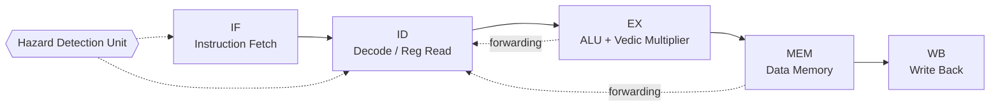

<div align="center">

# VedicALU-64X

**A 64-bit, 5-stage pipelined RISC processor built around a hierarchical Urdhva Tiryagbhyam (Vedic) multiplier.**


</div>

---

## Overview

VedicALU-64X is a complete 64-bit RISC processor designed in Verilog, where the arithmetic unit applies **Urdhva Tiryagbhyam** ("vertically and crosswise"), a sutra from Vedic mathematics, to build a scalable multiplier. The project explores a simple question from the intersection of Indian Knowledge Systems and VLSI design: *can ancient multiplication techniques map cleanly onto modern digital hardware, and how do they compare with a conventional multiplier?*

The design covers the full flow from architecture to verification:

- A classic **5-stage pipeline** with hazard detection and operand forwarding
- A **hierarchical Vedic multiplier** that scales from 2×2 up to 64×64
- A **custom ISA** with a **Python assembler** for writing test programs
- **545 self-checking assertions** across three testbenches, all passing

---

## Key Features

| Area | Details |
|---|---|
| **Datapath** | 64-bit RISC processor |
| **Pipeline** | 5 stages: IF → ID → EX → MEM → WB |
| **Hazard handling** | Hazard detection unit plus operand forwarding |
| **Multiplier** | Hierarchical Urdhva Tiryagbhyam multiplier, 2×2 up to 64×64 |
| **ISA** | Custom instruction set (see [ISA](#instruction-set-architecture)) |
| **Toolchain** | Python assembler that converts assembly to machine code |
| **Verification** | 3 self-checking testbenches, 545 passing assertions |
| **Simulation** | Icarus Verilog |

---

## Architecture



<!-- TODO: add your full block diagram here -->
<!--  -->

### Pipeline stages

| Stage | Responsibility |
|---|---|
| **IF** | Fetch instruction from instruction memory, update PC |
| **ID** | Decode instruction, read register file, generate control signals |
| **EX** | ALU operations and Vedic multiplication, branch resolution |
| **MEM** | Load/store access to data memory |
| **WB** | Write result back to the register file |

### Hazard management

- **Data hazards:** resolved with operand forwarding from the EX and MEM stages, falling back to a stall when forwarding alone is not enough (for example, load-use).
- **Control hazards:** handled by the hazard detection unit.

<!-- TODO: confirm and adjust the exact stall / flush behavior to match your RTL -->

---

## The Vedic Multiplier

**Urdhva Tiryagbhyam** generates all partial products in parallel and sums them "crosswise," which avoids the carry-propagation chain of a shift-and-add multiplier.

For two 2-bit numbers `a1a0` and `b1b0`:

```
bit 0 :  a0·b0
bit 1 :  a1·b0 + a0·b1
bit 2 :  a1·b1 + carry
```

The multiplier is built **hierarchically**: each larger multiplier is composed of four smaller ones plus adders.

```
2×2  →  4×4  →  8×8  →  16×16  →  32×32  →  64×64
```

This modular structure keeps the design reusable and easy to verify at every level.

---

## Instruction Set Architecture

<!-- TODO: fill this table from your ISA spec -->

| Type | Instructions | Description |
|---|---|---|
| Arithmetic | `ADD`, `SUB`, `MUL`, ... | Register-register arithmetic, `MUL` uses the Vedic multiplier |
| Logical | `AND`, `OR`, `XOR`, ... | Bitwise operations |
| Memory | `LD`, `ST` | Load / store |
| Control | `BEQ`, `JMP`, ... | Branch and jump |

Instruction format and encoding: see [`docs/isa.md`](docs/isa.md).

---

## Repository Structure

```
VedicALU-64X/
├── rtl/            # Processor, pipeline stages, hazard unit, Vedic multiplier
├── tb/             # Self-checking testbenches
├── assembler/      # Python assembler and sample programs
├── docs/           # Block diagrams, paper, synopsis, results
├── scripts/        # Simulation helper scripts
├── README.md
└── LICENSE
```

---

## Getting Started

### Prerequisites

- [Icarus Verilog](https://steveicarus.github.io/iverilog/) (`iverilog`, `vvp`)
- Python 3.8+
- (Optional) [GTKWave](https://gtkwave.sourceforge.net/) for waveforms
- (Optional) Xilinx Vivado for synthesis and timing analysis

```bash
# Ubuntu / WSL
sudo apt update
sudo apt install iverilog gtkwave python3
```

### Clone

```bash
git clone https://github.com/<your-username>/VedicALU-64X.git
cd VedicALU-64X
```

### Run the testbenches

<!-- TODO: replace file names with your actual ones -->

```bash
# Example: top-level processor testbench
iverilog -o sim tb/tb_processor.v rtl/*.v
vvp sim
```

A passing run ends with a summary of the self-checking assertions.

### Assemble a program

<!-- TODO: replace with your real assembler usage -->

```bash
python3 assembler/assembler.py programs/sample.asm -o programs/sample.hex
```

### View waveforms

```bash
gtkwave dump.vcd
```

---

## Verification

Verification is done with **three self-checking testbenches** that compare actual outputs against expected results automatically, so a run reports pass/fail without manual waveform inspection.

| Testbench | Scope |
|---|---|
| `tb_<name1>.v` | <!-- e.g. Vedic multiplier, all widths --> |
| `tb_<name2>.v` | <!-- e.g. ALU / datapath --> |
| `tb_<name3>.v` | <!-- e.g. full pipeline, hazards, forwarding --> |

**Result: 545 / 545 assertions passing.**

---

## Results: Vedic vs Standard Multiplier

<!-- TODO: fill in after the Vivado timing/area comparison is complete -->

| Metric | Vedic (Urdhva Tiryagbhyam) | Standard (`*` operator) |
|---|---|---|
| Max delay / critical path | TBD | TBD |
| LUT usage | TBD | TBD |
| Estimated power | TBD | TBD |
| Target device | TBD | TBD |

> Synthesis settings, constraints, and tool version are documented in [`docs/results.md`](docs/results.md).

---

## Documentation

- [`docs/`](docs/): block diagrams, synopsis, and project paper
- IEEE-format paper: <!-- TODO: link if you choose to make it public -->

---

## Background and Motivation

This project grew out of an interest in applying **Indian Knowledge Systems (IKS)** to modern semiconductor design. Vedic mathematics offers multiplication methods that are naturally parallel, which makes them a good fit for hardware. VedicALU-64X was presented at a national-level IKS conclave in 2026.

---

## Roadmap

- [ ] Complete Vivado timing, area, and power comparison
- [ ] Add FPGA implementation results
- [ ] Extend the testbenches with constrained-random verification
- [ ] Explore a SystemVerilog / UVM-style verification environment
- [ ] Extend the ISA

---

## Author

**Rahul**
Final-year B.E. ECE, Bangalore Technological Institute (VTU), Bengaluru
Interested in VLSI RTL Design and Verification

- GitHub:https://github.com/Pakeergowda-VLSI
- LinkedIn:https://www.linkedin.com/in/pakeergowda-rh/
- Email: pakeergowdarh@gmail.com

---

## License

Released under the [MIT License](LICENSE).
